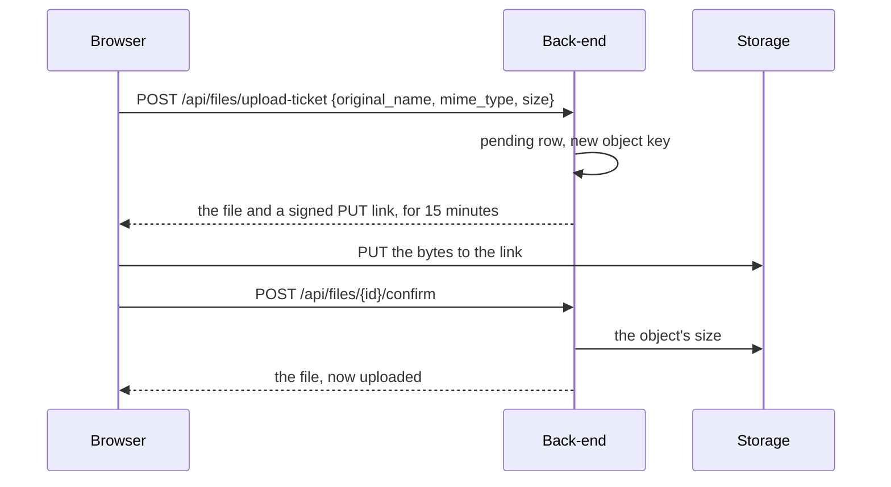

# File storage

How a file's bytes reach a storage and come back, with signed links, and what happens on soft delete and delete.

## Upload

The browser sends the bytes straight to the storage; the back-end only allows the upload and then checks it:

- **The ticket** checks the size against `FILES_MAX_SIZE`, records a `pending` row and signs a `PUT` for exactly that
  object: its key, its size, its type and its `Content-Disposition` with the original name
  ([RFC 6266](https://www.rfc-editor.org/rfc/rfc6266)). The key is a new UUID with the name's extension, so two
  uploads never collide and a name from the client never becomes a path.
- **The confirmation** asks the storage for the object's size. Only a `pending` file whose object has the size the
  ticket allowed becomes `uploaded`; an object of another size is removed. The client saying it is done is not
  evidence; the storage's answer is.
- **An abandoned upload**, still `pending` six hours after its ticket, is removed with its object by a task the
  back-end runs every 15 minutes.

Only `uploaded` files are listed, read or downloaded.

## Download

`GET /api/files/{id}/download-link` signs a `GET` for the object, valid for five minutes, which answers with the file's
type and `Content-Disposition: attachment` with its original name. The front-end's `/files/{id}/download` asks for a
link at each click and redirects to it, so a page left open never holds an expired link.

## Two storages

`FILES_STORAGE` chooses where new uploads go; each file keeps the storage it was uploaded to (`storage_type`), so
reading and deleting go to the right one after the setting changes.

| Storage | Adapter            | Bytes                     | Links                                                                     |
|---------|--------------------|---------------------------|---------------------------------------------------------------------------|
| `s3`    | `S3FileStorage`    | a private bucket          | presigned with AWS Signature Version 4, to `S3_PUBLIC_ENDPOINT`           |
| `local` | `LocalFileStorage` | `FILES_UPLOAD_DIR` folder | signed with HMAC-SHA256 and `FILES_SIGNING_KEY`, to `/uploads/{key}` here |

The bucket allows no public reading: a link is the only way in, and it expires. The local links are served by the
back-end's `/uploads` routes, which the front-end passes on, so the browser sends the bytes to the same origin. Those
routes check the signature, the expiry and, for an upload, the type and the exact size, and need no session: the
signature is the permission, as it is for the bucket.

## Soft delete and delete

- **Soft delete** marks the row deleted, recording who did it and when, and keeps the bytes; listing and reading no
  longer return it.
- **Delete** removes the object from its storage, then the row.

Listing, reading and asking for a download link need `FILES_VIEW`; a ticket, a confirmation, changing metadata and
both kinds of deletion need `FILES_MANAGE` ([Authorization](../../../../../docs/authorization.md)).
