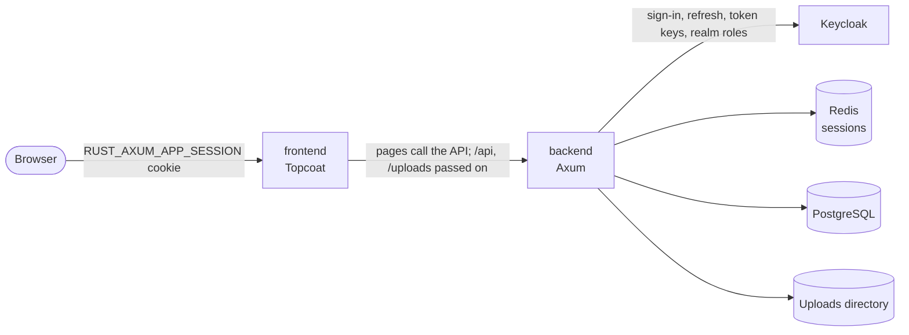

# Architecture

## Two applications



| Application                                     | What it is                                                                 |
|-------------------------------------------------|----------------------------------------------------------------------------|
| `frontend` ([front-end](../frontend/README.md)) | server-rendered pages on Topcoat, and a proxy to the back-end's API        |
| `backend` ([back-end](../backend/README.md))    | an Axum API over PostgreSQL and Redis, built as the modular monolith below |

The browser talks only to the front-end. It renders each page on the server, calling the back-end's API with the
browser's session cookie, and passes `/api/*` and `/uploads/*` on to the back-end, so the back-end's
cookies are set on the front-end's address and every call is same-origin. The front-end holds no token and no session
of its own.

## A modular monolith with hexagonal modules

The back-end is one binary made of three modules, each split into the same three layers:

| Module                                                  | Holds                                                                         |
|---------------------------------------------------------|-------------------------------------------------------------------------------|
| [`identity`](../backend/src/identity/README.md)         | sign-in, sessions, token verification and the accounts mirrored from Keycloak |
| [`files`](../backend/src/files/README.md)               | uploads stored on the local disk, with their metadata in PostgreSQL           |
| [`translations`](../backend/src/translations/README.md) | the message catalog, its defaults and the admin overrides                     |

| Layer            | Holds                                                                           |
|------------------|---------------------------------------------------------------------------------|
| `domain`         | entities, value types, errors and the repository traits; no I/O                 |
| `application`    | the service and its use cases, and the ports: traits for everything outside     |
| `infrastructure` | the adapters: HTTP routes, Toasty persistence, Keycloak, Redis, the file system |

Dependencies point inwards: `infrastructure` implements the ports of `application`, which uses `domain`. Each
module's `application/testing` holds in-memory fakes of its ports, so a use case is tested without a database or
Keycloak.

Between modules, one uses another only through the public API its `mod.rs` re-exports, and only in one direction:
`files` uses the auth guards of `identity`, and `identity` never imports `files`. What every module shares sits in two
modules of its own: `shared_kernel` holds plain value types a domain may use, such as a page request or the messages a
module ships, with no I/O; `shared_http` holds what the HTTP adapters share, the RFC 9457 problem documents and the
paging parameters and responses.

## The composition root

`backend/src/bootstrap` is the only place that names a concrete adapter. A service is generic over its ports, and
`bootstrap` fixes them with type aliases (`AppIdentityService`, `AppFilesService`, `AppTranslationsService`), so wiring
is resolved at compile time with no container and no trait objects. Adding a port to `identity` is one associated type
in `IdentityPorts`.

`bootstrap` also decides which routers sit behind the auth guard; a module only provides its routes.

## Routes

The routes are declared in each module's `infrastructure/http/routes`, and `bootstrap::router` nests each module's
router under its path and decides which sit behind the auth guard. There is no OpenAPI description; the routes and
their extractors are the reference.

A handler states what it needs through its extractor: `Auth` for a signed-in caller, `Permitted<P>` for a caller whose
roles grant the permission `P`. Each module declares the permissions it checks: [Authorization](authorization.md).

## Collections are paged

`GET /api/files`, `/api/users`, `/api/admin/roles` and `/api/admin/translations` take `page`, from 0, and `size`, 1
to 100 and 20 by default; a size out of range is a validation problem. They answer one page with its totals:

```json
{
  "content": [{ "id": 7, "original_name": "report.pdf" }],
  "page": 0,
  "size": 20,
  "total_elements": 57,
  "total_pages": 3
}
```

Files and accounts, which grow with use, are paged by the database, with `LIMIT`, `OFFSET` and a count; the newest files
come first, accounts in the order they were mirrored. Roles and messages, bounded by the code and the configuration, are
paged in memory, and `/api/admin/translations` also takes `q`, which keeps the messages whose key or text, in either
language, holds it. `PageRequest` and `PageResult` are in `shared_kernel`, `PageQuery` and `PageResponse` in
`shared_http`.

## Errors are message keys

Every refusal is an RFC 9457 problem document carrying a message key instead of a sentence: [Error
responses](mechanisms/error-responses.md).

## Database

PostgreSQL through the Toasty ORM. Each module keeps its persistence records in `infrastructure/persistence/records`,
separate from the domain types, and converts between the two in its repository.
