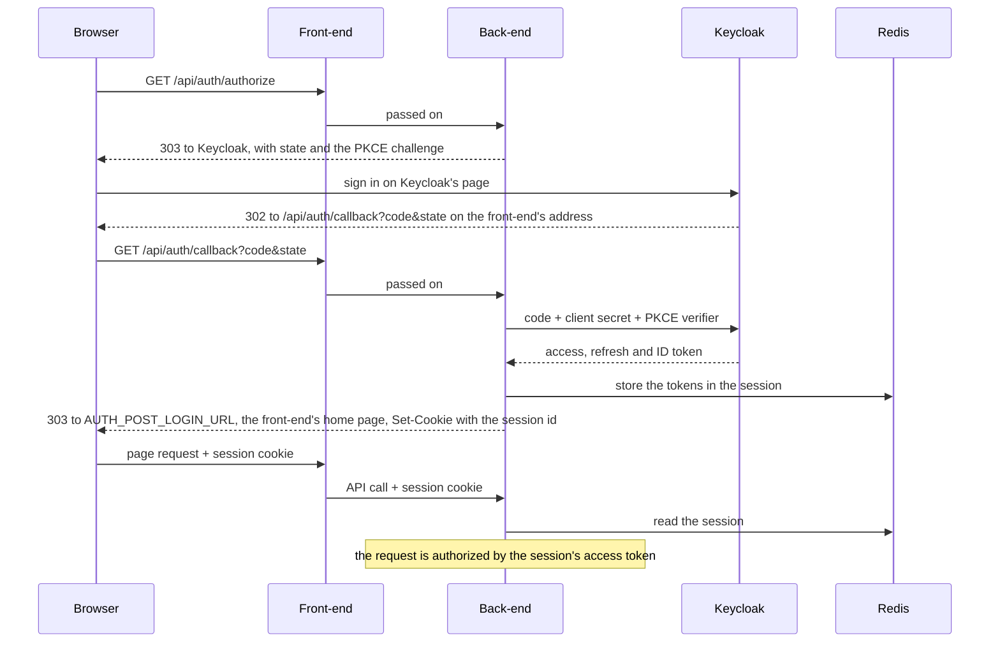

# Authentication

The application never handles a credential. Keycloak (realm `rust-axum-app`) owns every page that touches one: sign-up,
sign-in, email verification, password reset, two-factor authentication and acceptance of the terms of use. The
back-end is a BFF: it runs the sign-in, keeps the tokens on the server and gives the browser only a session cookie. The
browser reaches it through the front-end, which passes `/api/*` on unchanged:
[Architecture: Two applications](architecture.md#two-applications).

## Signing in



1. The browser opens `GET /api/auth/authorize`. The application stores a fresh `state` and PKCE verifier in the session
   and redirects to Keycloak with the challenge. Optional parameters pass through: `register=true` opens the sign-up
   page, and `kc_action` starts one of `CONFIGURE_TOTP`, `UPDATE_PASSWORD` or `delete_credential`. The `Accept-Language`
   header picks Keycloak's language when it is `pl` or `en`, as `ui_locales`. Keycloak shows a signed-in person the
   language stored on their account instead, so before a `kc_action` the application stores that language there, through
   the admin API.
2. Keycloak returns to `GET /api/auth/callback`. The application checks that the `state` is the one it issued to this
   browser, exchanges the code with the confidential client `rust-axum-app` and its secret, verifies the access token
   and mirrors the account into PostgreSQL.
3. It then issues a new session identifier, stores the tokens in the session and redirects to `AUTH_POST_LOGIN_URL`.
   When the account cannot be written it ends the Keycloak session again; any failure redirects with
   `?error=sign_in_failed`, and a `state` this browser was not given with `?error=state_mismatch`.

The browser holds only the `RUST_AXUM_APP_SESSION` cookie: `HttpOnly`, `SameSite=Lax`, and `Secure` when
`SESSION_COOKIE_SECURE=true`.

## Every request is authorized by a token

`authenticate`, the middleware `bootstrap` layers onto the protected routers, takes the access token from
`Authorization: Bearer` or, for a browser, from its session. `JwksTokenVerifier` checks the signature against
Keycloak's published keys (cached by key id), the issuer, the expiry and the audience (`KEYCLOAK_AUDIENCE`), and the
roles come from `realm_access.roles`. The resulting `Caller`, with what its roles grant, is what `Auth` and
`Permitted` read: [Authorization](authorization.md).

Either way the decision rests on the token alone, so any instance can serve any request.

## Sessions and refreshing

The session lives in Redis, and its access token is refreshed once per refresh token, across instances: [Token
refresh](../backend/src/identity/docs/mechanisms/token-refresh.md).

## Signing out

`POST /api/auth/logout` revokes the refresh token at Keycloak, which ends the Keycloak session, and clears the local
one. The front-end's sign-out button posts to its own `/sign-out`, which calls it with the session cookie, passes the
cookie's removal on to the browser and returns home.

## Cross-site requests

An unsafe request from another site gets no token: [Cross-site
requests](../backend/src/identity/docs/mechanisms/cross-site-requests.md).

## The sign-in pages

Keycloak draws the sign-in, sign-up, password reset, terms and second-factor pages, and the mails it sends, with the
theme in [`keycloak/themes/rust-axum-app`](../keycloak/themes/rust-axum-app), so they look like the front-end:

| Part                      | Holds                                                                                        |
|---------------------------|----------------------------------------------------------------------------------------------|
| `login/theme.properties`  | extends Keycloak's `keycloak.v2`, whose templates draw every page                            |
| `login/template.ftl`      | the page frame: the front-end's top bar, with the theme and language menus, and its footer   |
| `login/resources`         | `css/app.css`, the front-end's colors, font and card on PatternFly; `js/theme.js`, the theme |
| `login/messages`          | the texts of the bar and the footer, in Polish and English, as the front-end words them      |
| `email/html/template.ftl` | the frame of every mail; the texts stay Keycloak's own, in Polish and English                |

The theme menu offers System, Light and Dark, as the front-end's does. The sign-in starts in the theme the reader chose
in the front-end: the front-end's proxy adds it to `/api/auth/authorize`, the back-end passes it to Keycloak as
`ui_theme`, and `theme.js` keeps it in the browser for Keycloak's address, where a choice in its own menu replaces it.
A realm that turns dark mode off gets the light theme and no menu.

`template.ftl` is a copy of `keycloak.v2`'s own, changed only where it says `rust-axum-app`. Keycloak builds its pages
from that template, so after an upgrade of Keycloak the copy is compared with the new release's and brought up to date.
The Keycloak theme workflow does the comparison: `keycloak/check-template.sh` fails when the template in the Keycloak
image of `docker-compose.local.yml` is not the one the copy was made from, recorded as `parentTemplateSha256` in
`theme.properties`, which changes with the copy. The colors are a copy of the front-end's tokens, and the front-end's
`keycloak_theme` test fails when the two differ. A mail's colors are those tokens as hex, since mail clients read
neither `oklch()` nor `light-dark()`. The links of the bar and the footer lead to the client's base URL, `baseUrl` in
the realm.

The realm names the theme in `loginTheme` and `emailTheme`. Locally, compose mounts the folder into Keycloak. A
Keycloak that serves several applications, each in its own realm, takes it as a JAR in `/opt/keycloak/providers`:

```bash
keycloak/build-theme.sh   # writes keycloak/target/rust-axum-app-keycloak-theme.jar
```

`keycloak/Dockerfile` builds an image holding that JAR in `/themes`, which the Keycloak theme workflow publishes on a
`keycloak-theme-v*` tag.

The realm file of that Keycloak names `rust-axum-app` in `loginTheme` and `emailTheme`, and another theme replaces
it by its own JAR and those two fields.

## Code

The paths are under `backend/src/`; the front-end's side is in its [README](../frontend/README.md).

| Path                                                 | Role                                               |
|------------------------------------------------------|----------------------------------------------------|
| `identity/infrastructure/http/routes/auth.rs`        | authorize, callback, session, logout               |
| `identity/infrastructure/http/extract.rs`            | the `authenticate` middleware, `Auth`, `Permitted` |
| `identity/infrastructure/keycloak/client.rs`         | code exchange, refresh, revocation                 |
| `identity/infrastructure/keycloak/shared_refresh.rs` | one refresh per refresh token across instances     |
| `identity/infrastructure/keycloak/verifier.rs`       | token verification against Keycloak's keys         |
| `identity/infrastructure/session_store.rs`           | the Redis session store                            |
| `identity/application/service.rs`                    | sign-in, refresh, sign-out and the account mirror  |
